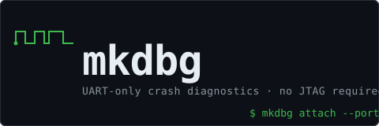

[](https://github.com/JialongWang1201/mkdbg/actions/workflows/ci.yml)
[](https://github.com/JialongWang1201/mkdbg/releases/latest)
[](LICENSE)

**Hardware-first debugging and crash forensics for Cortex-M, multicore SoCs, and Linux kernels.**

Use mkdbg to check board power, reset, and boot timing, inspect a core, or trace what happened before a fault. On MCU firmware with the `wire` agent, you can capture faults and debug over the same UART connection you use for logs. mkdbg also supports hardware probes, multicore captures, and Linux kernel crash dumps.

[Quick start](#quick-start) · [Documentation](#documentation) · [Community](#community)

---

## Install

```bash
curl -fsSL https://raw.githubusercontent.com/JialongWang1201/mkdbg/main/scripts/install.sh | bash
export PATH="$HOME/.local/bin:$PATH"
mkdbg --version
```

The installer tries the rolling `latest` build first and falls back to a source build if the binary is unavailable. Linux binaries require glibc 2.34 or newer (Ubuntu 22.04, Debian 12, or equivalent). To pin a version, download its binary. [Versioned releases](https://github.com/JialongWang1201/mkdbg/releases)

| Platform | Binary |
|----------|--------|
| Linux x86\_64 | `mkdbg-native-linux-x86_64` |
| Linux arm64 | `mkdbg-native-linux-arm64` |
| macOS Apple Silicon | `mkdbg-native-darwin-arm64.zip` (versioned releases) |
| macOS Intel | `mkdbg-native-darwin-x86_64.zip` (versioned releases) |

Verify downloads with `SHA256SUMS`. Linux users downloading an individual binary
must also run `chmod +x mkdbg-native-linux-*`. Versioned macOS archives are signed
and notarized; the `curl` installer continues to select the raw binary automatically.

---

## Quick start

**Try a sample without hardware.** With Git and Python 3.10+, run the board timing tool on a simulated oscilloscope and logic-analyzer capture. The report shows the measured intervals for the power rail, reset release, and boot marker.

```bash
git clone --depth 1 https://github.com/JialongWang1201/mkdbg.git
cd mkdbg
python3 tools/board_evidence.py tests/fixtures/platform/board.json \
  --samples scope=tests/fixtures/platform/scope.csv \
  --samples logic=tests/fixtures/platform/logic.csv
```

**Capture your first MCU fault.** Connect a board running firmware with the `wire` agent and use its serial device path. For build and board setup, see the [STM32F446 example](examples/stm32f446/README.md).

```bash
mkdbg attach --port /dev/ttyUSB0
```

---

## Add to your firmware

Link the `wire` agent into your project — ~300 lines of C99, no OS dependencies:

```c
// 1. Call from your fault handler:
wire_on_fault();

// 2. Implement two UART functions:
void wire_uart_send(const uint8_t *buf, size_t len) { /* your HAL */ }
void wire_uart_recv(uint8_t *buf, size_t len)       { /* your HAL */ }
```

The porting guide walks through the UART functions, fault hook, and build integration.

[Porting guide](docs/PORTING.md) · [STM32F446 reference implementation](examples/stm32f446/)

---

## What you can do

**Crash report** — decode a fault the moment it happens:
```bash
mkdbg attach --port /dev/ttyUSB0 --explain
mkdbg attach --probe --chip STM32F446RETx   # hardware probe
```

**Live debug session** — breakpoints, step, registers, inline disassembly, FreeRTOS task names:
```bash
mkdbg debug --port /dev/ttyUSB0 --elf build/firmware.elf
mkdbg debug --probe --chip STM32F446RETx --elf build/firmware.elf
```

**Causal analysis.** Inspect the recorded events leading up to a fault.
```bash
mkdbg seam analyze capture.cfl
```

**Incident handoff** — export and compare crash artifacts:
```bash
mkdbg incident export
mkdbg replay .mkdbg/incidents/<id>/bundle.json
mkdbg diff crash-before.json crash-after.json
```

**GDB bridge** — connect `arm-none-eabi-gdb` without a hardware probe:
```bash
wire-host --port /dev/ttyUSB0
```

**Platform diagnostics**

- Check target reachability with `mkdbg probe status` and compare board timing across calibrated instrument captures. [Board bring-up](docs/COMMANDS.md#board-and-soc-debug)
- Attach GDB to individual cores, collect status and trace data across core groups, and decode named register fields. [SoC inspection](docs/COMMANDS.md#soc-core-and-trace-inspection)
- Match retained STM32F446 faults to the firmware's ELF build ID and inspect FreeRTOS context from the previous boot. [Firmware evidence](docs/COMMANDS.md#firmware-identity-after-reset)
- Connect to a running kernel through KGDB or analyze a kdump `vmcore` with its matching `vmlinux`. [Linux kernel debug](docs/COMMANDS.md#linux-kernel-debug)

---

## Architecture support

| | Cortex-M (M0/M3/M4/M7) | RISC-V 32 |
|--|:---:|:---:|
| Crash report | ✓ | ✓ |
| Live debug TUI | ✓ | ✓ |
| FPU registers | ✓ | — |
| Hardware probe | ✓ | — |

The built-in disassembler covers the full Thumb/Thumb-2 instruction set including FPU (VFPv4). No dependency on `objdump` or `addr2line`.

---

## Hardware probe support

mkdbg supports ST-Link, CMSIS-DAP, and J-Link via [probe-rs](https://probe.rs).

On Linux, USB access requires a udev rule:
```bash
sudo cp tools/69-probe-rs.rules /etc/udev/rules.d/ && sudo udevadm control --reload
```

---

## Documentation

| | |
|-|-|
| [`docs/COMMANDS.md`](docs/COMMANDS.md) | Full command reference and config format |
| [`docs/PORTING.md`](docs/PORTING.md) | Porting the firmware agent to a new board |
| [`docs/DEVELOPER_GUIDE.md`](docs/DEVELOPER_GUIDE.md) | Build system, testing, adding arch plugins |
| [`CONTRIBUTING.md`](CONTRIBUTING.md) | Contribution workflow, engineering standards, and validation |

---

## Community

You can contribute with a board on your bench or with the sample captures in this repository. A clearer setup step, a reproducible bug report, or a small test fixture can help the next person debug the same problem.

- **Ask a question, report a bug, or propose a feature.** Search existing issues first. For a bug, include your mkdbg version, host OS, and the command you ran. For a hardware issue, add the board or chip revision and the transport or probe. A short sanitized log helps with reproduction. [GitHub Issues](https://github.com/JialongWang1201/mkdbg/issues)
- **Make a first contribution.** Try the sample capture, improve a setup example, or contribute a sanitized regression fixture. The host test suite runs without a board or probe. Open pull requests against `next`. [Contribution guide](CONTRIBUTING.md)
- **Help support a new board or target.** Open an issue with the revision, debug configuration, and checks you can run. Board profiles, porting notes, and reproducible bench captures are welcome. [Porting guide](docs/PORTING.md)
- **Report a vulnerability privately.** Follow the reporting instructions in the [security policy](SECURITY.md).

---

## License

mkdbg is released under the MIT License. Submodules carry their own license terms. [License](LICENSE)
